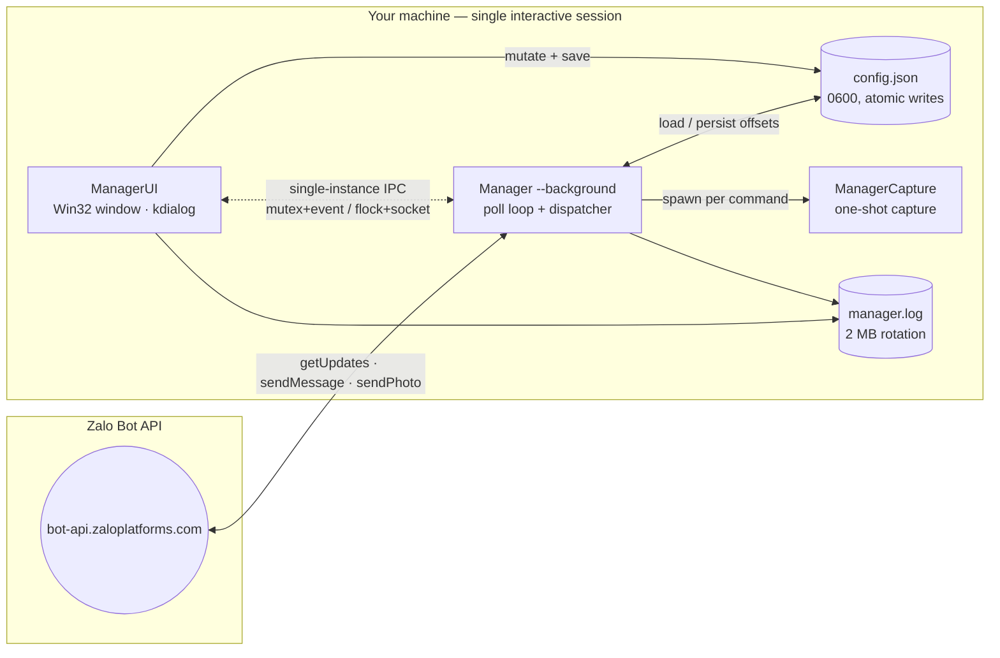
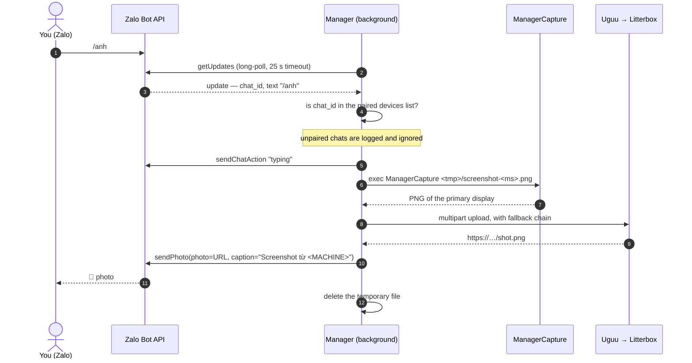

<div align="center">

# ScreenPilot

**Your PC's screen, one Zalo message away.**

A tiny, dependency-free Go agent that listens for commands in a Zalo bot chat and answers with a live screenshot of your primary display.

[](https://github.com/Dyu-36/ScreenPilot/actions/workflows/linux-build.yml)
[](https://github.com/Dyu-36/ScreenPilot/actions/workflows/pr-windows.yml)


</div>

---

> **A note on names.** This project used to live at `Dyu-36/screenshot` and the app introduced itself as *Manager*. The repository is now **ScreenPilot**; the executables keep their `Manager*` names so existing installs, autostart entries and configuration keep working untouched.

## Why ScreenPilot?

Sometimes you just need to *see* the machine — is the build still running, did the installer stall, what did that dialog box say? Remote desktop is overkill, and opening an inbound port is a bad idea.

ScreenPilot flips the direction: your PC **polls** the Zalo Bot API over an outbound HTTPS connection and never listens for inbound traffic. Pair a chat once, then type `/anh` from your phone and get a PNG back in a couple of seconds.

```text
You (Zalo)  ──/anh──▶  Zalo Bot API  ◀──long-poll──  ScreenPilot  ──▶  📸 PNG
                              ▲                                       (primary display)
                              └────────── sendPhoto(url) ◀────────────┘
```

## Features

| | |
|---|---|
| 📸 **One-command screenshots** | `/anh` captures the primary display and delivers it as a photo captioned with the machine name. |
| 🔌 **No inbound ports** | Outbound long-polling only — works behind NAT, CGNAT and corporate firewalls. |
| 🪶 **Single static binary** | Pure Go with `CGO_ENABLED=0`; the Win32 UI is written against `syscall` directly, so nothing else has to be installed. |
| 🖥️ **Native on both platforms** | Win32 window on Windows, KDE `kdialog` menus on Linux — no webview, no Electron, no runtime. |
| 🔐 **Paired-chat allowlist** | Commands from any chat that is not explicitly paired are ignored and logged. |
| 🤖 **Multi-bot management** | Keep several bot tokens and switch the active one from the GUI; exactly one bot polls at a time by design. |
| ♻️ **Survives restarts** | Update offsets are persisted, so a reboot never replays yesterday's commands. |
| 🖼️ **Delivery that retries itself** | If Zalo rejects an image URL, the agent falls back to the next temporary host automatically. |
| 🚀 **Zero-touch autostart** | Registers itself for background startup *only* after a bot is configured. |

## Architecture

### Processes

ScreenPilot ships three executables that cooperate rather than one monolith:

| Binary | Role |
|---|---|
| **Manager** | Entry point. Opens the GUI by default; with `--background` it runs the polling agent. |
| **ManagerUI** | The configuration surface (Win32 window / kdialog menus). Hands off to `Manager --background` when you hide it. |
| **ManagerCapture** | A short-lived, single-purpose capture process. Spawned per screenshot, exits immediately. |

### Topology



### Anatomy of a screenshot



### Package map

```text
cmd/
  manager/          CLI entry point: GUI launch, --background agent, --capture one-shot
  manager-ui/       GUI process; single-instance handoff to the background agent
  manager-capture/  minimal capture-only binary — no UI, no network
internal/
  agent/            poll loop, command dispatch, pairing state machine
  zalo/             typed Zalo Bot API client (never leaks the token)
  screenshot/       Windows GDI · Linux KWin ScreenShot2 → portal → spectacle/scrot
  media/            temporary image hosts with an accept/retry contract
  config/           schema, normalization, atomic persistence, legacy migration
  ipc/              cross-process single-instance lock and handoff signalling
  platform/         autostart registration, desktop integration, native dialogs
  ui/               Win32 window / kdialog flows
  worker/           spawning sibling executables and validating their output
  logging/          rotating, timestamped, single-line log writer
  appinfo/          name and build-time version
```

### Design notes

The interesting parts are the *why*s:

- **Capture lives in its own process.** Windows DPI awareness (`SetProcessDpiAwarenessContext`) is process-wide and must be set before any window exists. Keeping capture in ManagerCapture means the GUI stays comfortably scaled while screenshots are taken at native resolution — and a misbehaving GDI call can never disturb the polling loop.
- **GDI on a locked OS thread.** A display DC must be acquired and released on the same thread, so capture runs under `runtime.LockOSThread()`.
- **Win32 through syscall, not cgo.** `RegisterClassExW`, `BitBlt`, `GetDIBits` and `CreateMutexW` are all called directly. The result is one statically linked `.exe` that needs no MinGW toolchain to build.
- **Images travel as URLs.** `sendPhoto` accepts a URL, so a capture is uploaded to a short-lived public host first. `media.UploadImageUntilAccepted` exposes an *accept callback*: if Zalo answers `424` (it could not fetch the URL), the next provider in the chain is tried instead of failing the command.
- **Pairing is a state machine, not a race.** `pairGate` serializes pairing attempts, and `updateMu` guarantees a cancelled poll has fully unwound before a new one consumes updates — otherwise a stale `/pair <old-code>` could be answered by a fresh attempt.
- **One active bot, always.** Two processes polling the same token steal each other's updates. `config.Normalize()` enforces exactly one active bot, and the UI flips that flag rather than running two pollers.
- **Single instance via the OS.** Windows uses a `Local\` mutex plus a named event; Linux uses `flock` plus a `0600` Unix socket in `XDG_RUNTIME_DIR`. The GUI signals the background agent, waits for it to release the lock, and only then exits — no window flicker, no gap in polling.
- **Config writes are atomic.** Marshalled to `config.json.tmp`, then renamed over the target with mode `0600`. A crash mid-write can never leave an unparsable configuration.
- **Autostart is conditional.** The Run key / desktop autostart entry appears only while at least one bot exists, and is removed when the last bot is deleted — no orphaned processes after an uninstall-by-configuration.

## Quick start

### Requirements

- **Windows 10/11** (x64), or **Linux with KDE Plasma** (X11 or Wayland)
- Go **1.23+** — only if you build from source
- A Zalo bot token from the [Zalo Bot Platform](https://bot.zaloplatforms.com)
- Linux GUI only: `kdialog` (`sudo pacman -S kdialog` on Arch/CachyOS)

### Build from source

```bash
git clone https://github.com/Dyu-36/ScreenPilot.git
cd ScreenPilot

# Windows
build-release.cmd

# Linux
./build-release.sh
```

Both scripts run `gofmt`, `go vet` and `go test ./...`, then emit three binaries into `dist/` with the version stamped in through `-ldflags -X`.

### Install

| Platform | Command | Installs to |
|---|---|---|
| Windows | double-click `install.cmd` | `%LOCALAPPDATA%\Manager\bin` + Start Menu shortcut |
| Linux | `./install.sh` | `~/.local/share/manager/bin` + `~/.local/bin` symlinks + desktop entries |

Neither installer needs administrator or root rights — an agent that reads your screen should never need elevated privileges.

Prebuilt bundles are attached to every [release](https://github.com/Dyu-36/ScreenPilot/releases) as `Manager-Windows-x86_64.zip` and `Manager-Linux-x86_64.tar.gz`, together with `SHA256SUMS.txt`.

### Pair your chat in 60 seconds

1. Launch **Manager**.
2. Paste the bot token — or press **Thêm bot** first if you already have saved bots — and click **Lưu & ghép cặp**.
3. The window shows a one-time code, for example `/pair 481920`.
4. Send exactly that command to *that* bot in Zalo within 60 seconds.
5. The agent confirms pairing, registers autostart and slips into the background.

> The token is validated with `getMe` before pairing starts and the bot webhook is deleted, so long-polling receives the message. Generating a new code invalidates the previous one.

### Commands

| Command | Aliases | What it does |
|---|---|---|
| `/anh` | — | Capture the primary display and send it as a photo. |
| `/status` | `/ping` | Report machine name, version, paired-device count and online state. |
| `/help` | `/start` | Show the command list. |
| `/pair` | — | Acknowledge that this chat is already paired. |
| `/unpair` | — | Remove *this* chat from the allowlist. |

Anything else gets a polite "not supported" reply, and commands from unpaired chats are dropped without a response.

<details>
<summary><strong>Hướng dẫn nhanh bằng tiếng Việt</strong></summary>

1. Tải bản phát hành mới nhất rồi giải nén.
2. **Windows:** chạy `install.cmd`. **Linux:** chạy `./install.sh` (đừng dùng `sudo`).
3. Mở **Manager**, dán Bot Token Zalo, bấm **Lưu & ghép cặp**.
4. Gửi lệnh `/pair <mã 6 số>` hiện trên cửa sổ cho đúng bot đó trong vòng 60 giây.
5. Xong. Nhắn `/anh` để nhận ảnh chụp màn hình, `/status` để kiểm tra máy còn online, `/unpair` để gỡ thiết bị.

Lưu ý: mỗi máy nên dùng **một bot token riêng**. Hai máy cùng poll một token sẽ tranh mất tin nhắn của nhau.

</details>

## Configuration and data

Everything lives in a per-user directory; nothing is written next to the binaries.

| | Windows | Linux |
|---|---|---|
| Config | `%APPDATA%\manager\config.json` | `$XDG_DATA_HOME/manager/config.json` (default `~/.local/share/manager`) |
| Log | `%APPDATA%\manager\manager.log` | `~/.local/share/manager/manager.log` |
| Autostart | `HKCU\Software\Microsoft\Windows\CurrentVersion\Run\Manager` | `~/.config/autostart/Manager.desktop` |
| Temp screenshots | `%TEMP%\manager\screenshot-<ms>.png` | `$TMPDIR/manager/screenshot-<ms>.png` |

```json
{
  "bots": [
    {
      "token": "123456789:AA…",
      "label": "Bot …9f2c",
      "added_at_unix": 1735689600,
      "active": true,
      "update_offset": 4815162342,
      "devices": [
        { "chat_id": "1234567890", "paired_at_unix": 1735689900 }
      ]
    }
  ]
}
```

The file is written `0600` on Unix and replaced atomically. The log rotates at 2 MB into `manager.log.1`; each line is timestamped and newline-escaped, so one entry is always one line.

**Automatic migration.** On first run ScreenPilot adopts configuration from earlier versions — the `tack-agent` data directory, a legacy `gotack/zalo.json`, or the `TACK_ZALO_BOT_TOKEN` environment variable — so an upgrade never loses a paired chat.

## Security and privacy

ScreenPilot is a remote-eye tool, so its boundaries are explicit:

- **No inbound listener.** The agent only makes outbound HTTPS requests to `bot-api.zaloplatforms.com`.
- **Allowlist, not authentication.** Only `chat_id` values stored in the config can trigger actions; everything else is ignored. Treat a paired chat as a credential.
- **Tokens never reach the log.** The Zalo client deliberately avoids wrapping `url.Error` — which embeds the request URL, and therefore the token — and surfaces only the method name plus a typed `APIError`.
- **Screenshots leave your machine.** The Bot API accepts images by URL, so a capture is uploaded to a temporary public host (Uguu, then Litterbox with one-hour retention) and that URL is sent to Zalo. Capture, upload and delivery happen only when a paired chat sends `/anh`; nothing is uploaded in the background. If that trade-off is unacceptable for your environment, `internal/media` is the single place to change — for example, point the `imageUploadAttempts` table at a host you control.
- **Least privilege.** Both installers are per-user and the agent never requests elevation. On Windows the session must be logged in with an unlocked desktop, otherwise GDI hands back a black frame.

## Troubleshooting

| Symptom | Likely cause | Fix |
|---|---|---|
| HTTP `404` while pairing | Token truncated, or belongs to another bot | Copy the **complete** token; a successful `getMe` does not mean the chat is paired. |
| Pairing times out after 60 s | Command sent to a different bot, or no `/pair` prefix | Send `/pair 123456` to the bot whose token you pasted. |
| Photo never arrives | Every upload host failed | Look for `stage=upload` / `stage=send` lines in `manager.log`. |
| Zalo answers `424` | Zalo could not fetch the image URL | The agent retries the next provider automatically; repeated failures point at the host. |
| Two machines fight over messages | Same bot token on both | Use one token per machine — updates go to whoever polls first. |
| Blank or black screenshot | Locked session, or DRM-protected content | Unlock the desktop; protected surfaces cannot be captured through GDI. |
| Linux GUI refuses to start | `kdialog` missing | `sudo pacman -S kdialog` on Arch/CachyOS, or your distribution's equivalent. |
| Linux capture fails on Wayland | KWin ScreenShot2 / portal unavailable | The agent falls back to `spectacle`, then to `scrot` on X11; install one of them. |

Logs are append-only and cheap to read:

```bash
tail -f ~/.local/share/manager/manager.log                              # Linux
Get-Content "$env:APPDATA\manager\manager.log" -Tail 50 -Wait           # Windows
```

## Development

```bash
gofmt -l ./cmd ./internal     # formatting gate used by CI
go vet ./...
go test ./...                 # pairing races, provider fallback, config, API client
```

**CI** — every push and pull request to `main` builds and tests on `ubuntu-latest` and `windows-latest`; `windows-build.yml` and `linux-build.yml` can also be dispatched manually.

**Releasing** — push a tag; the workflow builds both platforms, packages the end-user bundles, writes `SHA256SUMS.txt` and publishes the GitHub Release:

```bash
git tag v3.1.0 && git push origin v3.1.0
```

The version string is injected at link time:

```bash
go build -ldflags "-X github.com/Dyu-36/screenpilot/internal/appinfo.Version=3.1.0" ./cmd/manager
```

**Conventions** — platform-specific code sits behind `//go:build` tags with `_windows` / `_linux` / `_other` suffixes, so `GOOS=linux go build ./...` works from any host. User-facing strings are Vietnamese (the product's audience); code, comments and documentation are English.

## Roadmap

- [ ] Multi-monitor selection (`/anh 2`)
- [ ] Optional local upload target instead of a public host
- [ ] macOS capture backend (the `_other` stubs are already in place)
- [ ] Tray icon instead of a window that hides itself

## License

No license has been chosen for this repository yet, which means all rights are reserved by default. If you intend to use, fork or redistribute ScreenPilot, open an issue so a license can be added first.

<div align="center">
<sub>Built with Go, syscall, and a healthy distrust of inbound ports.</sub>
</div>
